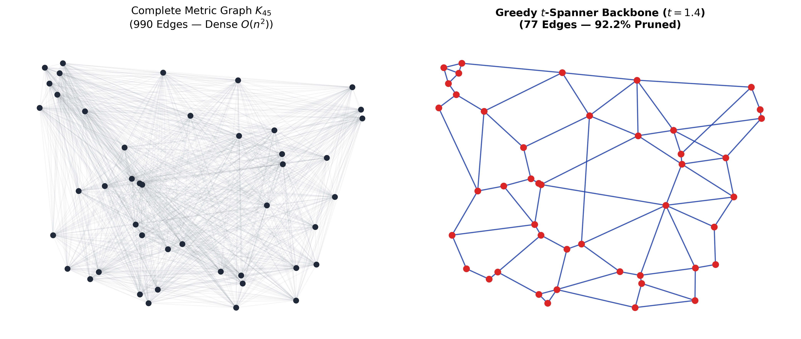
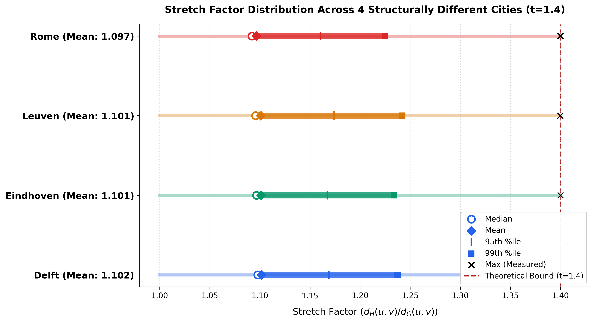

# Geometric Spanners Lab: Greedy $t$-Spanner Benchmark

  
  
  

A clean, reproducible research implementation and benchmarking lab for **Greedy $t$-Spanner Construction Algorithms** on 2D metric spaces.

---

## 📌 Theoretical Foundations

Given a complete geometric metric graph $G = (V, E)$ embedded in Euclidean space $\mathbb{R}^2$, a subgraph $H = (V, E_H)$ is defined as a **$t$-spanner** if:

$$\forall u, v \in V, \quad d_H(u, v) \le t \cdot d_G(u, v)$$

where $t \ge 1$ represents the **stretch factor** (dilation bound). 

The classical **Greedy Algorithm** sorts all candidate edges by ascending Euclidean length and adds an edge $(u, v)$ to $H$ if and only if the current shortest path distance in $H$ satisfies:

$$d_H(u, v) > t \cdot \|p_u - p_v\|_2$$

---

## 📊 Empirical Baseline ($n = 45, t = 1.40$)

| Metric Property | Complete Dense Graph ($K_{45}$) | Greedy $t$-Spanner ($H$) | Sparsity / Reduction |
| :--- | :---: | :---: | :---: |
| **Total Edges** | **990** | **77** | **92.22% Pruned** |
| **Stretch Factor ($t$)** | 1.00 | $\le 1.40$ | *Strict Invariant* |
| **Asymptotic Density** | $\mathcal{O}(n^2)$ | $\mathcal{O}(n)$ | Sparse Backbone |

 

  

---

## Independent Verification

`verify_independent.py` is deliberately separate from the pipeline. It re-derives the headline numbers with its own code path (heap-based Dijkstra for construction, scipy all-pairs shortest paths for stretch) and then compares them with the README and with the pipeline's own output: edge counts (990 / 77 / 92.22%), exhaustive maximum stretch over all pairs, connectivity, and edge-set equality with `greedy_spanner.py`. It also checks that `osm_experiments/results.json` is internally consistent. A self-test with analytically known controls runs first (a planted gap with stretch exactly 3.0, a disconnected graph that must be reported as infinite, and a complete graph with stretch 1.0). It needs no network access.

    python verify_independent.py

**Scope note for the OpenStreetMap experiments.** `osm_experiments/` uses only the node coordinates of each road network (Euclidean metric). Road connectivity and one-way restrictions are ignored, and "% pruned" is measured against the complete graph over those nodes, not against the road graph's own edges. Road-aware, directed constructions are addressed in the sibling repositories listed under Research Program.

## Research Program

This repository is one component of a connected research program on emergency-aware urban network control. The four repositories share a problem family, not code: each is self-contained and makes claims only within its own tested scope.

| Repository | Setting | Role in the program | Type of guarantee |
| --- | --- | --- | --- |
| **[`geometric-spanners-lab`](https://github.com/soheylfalahzade/geometric-spanners-lab) (this repository)** | Euclidean point sets, undirected | Classical greedy t-spanner baseline | Exact by construction; independently re-derived by `verify_independent.py` |
| [`Research_Geometric_ML_Optimization`](https://github.com/soheylfalahzade/Research_Geometric_ML_Optimization) | Directed OpenStreetMap road graphs | Same spanner problem, with learned (GNN + fuzzy) edge pruning for speed | Per-edge local repair guarantee; global stretch validated empirically by Monte Carlo sampling (small nonzero violation rate in one city, disclosed in that repository) |
| [`delay-bounded-spanner-networks`](https://github.com/soheylfalahzade/delay-bounded-spanner-networks) | Directed road graphs with hourly speed profiles | Same problem under a time-varying delay constraint | Certified: an edge-wise certificate implies the all-pairs, all-hours bound (Theorem 1); congestion model is parametric, not fitted to telemetry |
| [`anti-gridlock-signal-control`](https://github.com/soheylfalahzade/anti-gridlock-signal-control) | Single signalized intersection (SUMO) | Local control layer beneath a future network layer | Empirical (10 paired seeds); no closed-loop stability proof |

**How the pieces fit.** The three spanner repositories form one line of work on sparse backbones of road networks: a classical greedy baseline, a machine-learning-accelerated variant on directed road graphs, and a variant that certifies a delay bound at every hour of the day. The signal-control repository is the local control layer that a network-level layer would sit above.

**Status.** Integration of the local control layer with the network layer is planned and has not been demonstrated. Principal open items per repository:

- `geometric-spanners-lab`: the OpenStreetMap experiments use node coordinates only (Euclidean metric), not road connectivity.
- `Research_Geometric_ML_Optimization`: efficiency does not transfer to Tokyo scale (0.09% of edges pruned), and the ablation study has not yet been re-run on all four cities with the final pipeline.
- `delay-bounded-spanner-networks`: the congestion field is parametric, not fitted to real traffic telemetry.
- `anti-gridlock-signal-control`: fuzzy membership functions are hand-set, only one intersection is tested, and closed-loop stability is open.

## 🚀 Quickstart & Reproducibility

    # 1. Clone the repository
    git clone https://github.com/soheylfalahzade/geometric-spanners-lab.git
    cd geometric-spanners-lab

    # 2. Install dependencies
    pip install -r requirements.txt

    # 3. Run the benchmark
    python greedy_spanner.py

---

## 📄 License
This project is licensed under the MIT License.
---

## 🌍 Real-World Validation (OpenStreetMap Road Networks)

The synthetic baseline above uses randomly distributed points. To test whether the same construction holds on real, structurally different urban topologies, the benchmark was extended to actual road networks (via OSMnx) for four cities:

| City | Nodes | Full Graph Edges | Spanner Edges | % Pruned | Verified Max Stretch |
|---|---|---|---|---|---|
| Delft, NL | 1,285 | 824,970 | 2,554 | 99.69% | 1.39997 |
| Eindhoven, NL | 1,332 | 886,446 | 2,610 | 99.71% | 1.39998 |
| Leuven, BE | 886 | 392,055 | 1,703 | 99.57% | 1.39975 |
| Rome, IT | 1,129 | 636,756 | 2,239 | 99.65% | 1.39997 |

**Independently verified stretch distribution** (Delft, all 824,970 pairs — not just the algorithm's own target):

| Statistic | Value |
|---|---|
| Mean | 1.102 |
| Median | 1.098 |
| 99th percentile | 1.237 |
| Max (measured, not assumed) | 1.39997 |

**Finding:** despite very different street topologies (canal-based Delft, planned-grid Eindhoven, medieval-organic Leuven, ancient-chaotic Rome), the stretch distribution is nearly identical across all four cities. Topology does not appear to be the dominant factor at this scale (800–1,300 nodes) — full verification code and distribution histograms are in `osm_experiments/`.

