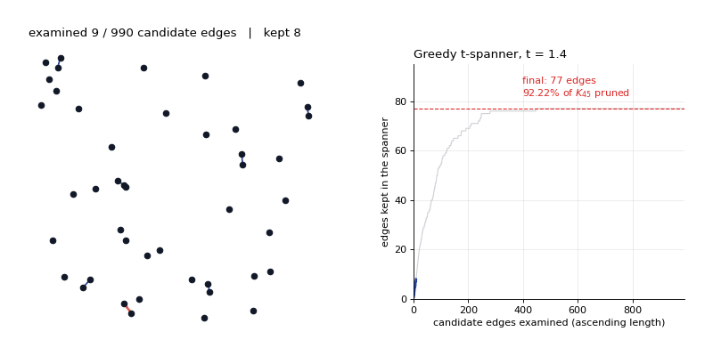
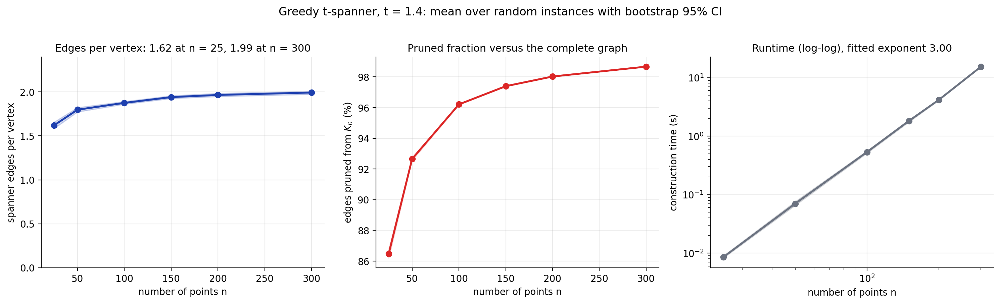
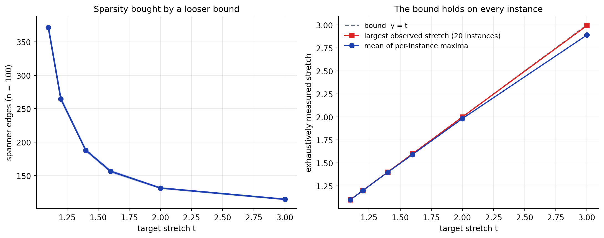

# Geometric Spanners Lab

**A reproducible reference implementation and benchmark of the greedy $t$-spanner on 2D point sets and road-network node sets, with an independent verifier.**

  
  
  
  

  

Greedy construction on 45 random points, $t = 1.4$: candidate edges are examined in ascending length; the orange edge is added, a red edge is skipped. The final spanner keeps 77 of 990 edges. Regenerate with <code>python make_animation.py</code>.

## Contents

1. [Problem and algorithm](#problem-and-algorithm)
2. [Results at a glance](#results-at-a-glance)
3. [Scaling and the stretch trade-off](#scaling-and-the-stretch-trade-off)
4. [Independent verification](#independent-verification)
5. [Road-network node sets (OpenStreetMap)](#road-network-node-sets-openstreetmap)
6. [Reproduce](#reproduce)
7. [Research program](#research-program)
8. [References and citation](#references-and-citation)

## Problem and algorithm

For a complete Euclidean graph $G = (V, E)$ on points in $\mathbb{R}^2$, a subgraph $H = (V, E_H)$ is a **$t$-spanner** if

$$\forall u, v \in V:\quad d_H(u, v) \le t \cdot d_G(u, v),$$

where $t \ge 1$ is the stretch factor. The greedy algorithm sorts all candidate edges by ascending length and adds $(u, v)$ if and only if the current shortest path in $H$ is too long:

$$d_H(u, v) > t \cdot \lVert p_u - p_v \rVert_2 .$$

Every skipped edge already has a path within the bound, and every added edge extends the graph, so the invariant holds for all pairs by construction.

## Results at a glance

Single reference instance ($n = 45$, seed 42, $t = 1.4$):

| Property | Complete graph $K_{45}$ | Greedy spanner $H$ |
| :--- | :---: | :---: |
| Edges | 990 | **77** (92.22% pruned) |
| Stretch bound | 1.00 | $\le 1.40$, verified on all 990 pairs |

  

One instance can be unrepresentative, so the next section reports distributions over many random instances.

## Scaling and the stretch trade-off

`benchmarks/scaling_study.py` builds spanners on 138 random instances ($n = 25$ to $300$, $t = 1.4$) and on 120 instances ($n = 100$, $t$ from 1.1 to 3.0). Stretch is measured exhaustively with scipy all-pairs shortest paths, independently of the construction code. All 258 spanners were connected and within their bound. Raw rows: `results/scaling_study.csv`, `results/t_tradeoff.csv`.

  

| $n$ | instances | edges per vertex | pruned from $K_n$ |
| ---: | ---: | ---: | ---: |
| 25 | 30 | 1.62 | 86.49% |
| 50 | 30 | 1.80 | 92.66% |
| 100 | 30 | 1.88 | 96.21% |
| 150 | 20 | 1.94 | 97.39% |
| 200 | 20 | 1.97 | 98.02% |
| 300 | 8 | 1.99 | 98.67% |

The edge count is close to linear in $n$, about two edges per vertex, which is consistent with the known linear size bound for greedy spanners of planar point sets. The fitted runtime exponent of this reference implementation is 3.00: it runs a shortest-path query per candidate edge (networkx) and is written for clarity, not speed.

  

| target $t$ | 1.1 | 1.2 | 1.4 | 1.6 | 2.0 | 3.0 |
| :--- | ---: | ---: | ---: | ---: | ---: | ---: |
| mean edges ($n = 100$) | 371.6 | 264.7 | 188.0 | 156.4 | 131.3 | 114.5 |
| largest measured stretch | 1.1000 | 1.2000 | 1.3999 | 1.5996 | 1.9996 | 2.9933 |

## Independent verification

`verify_independent.py` is deliberately separate from the pipeline. It re-derives the headline numbers with its own code path (heap-based Dijkstra for construction, scipy all-pairs shortest paths for stretch) and compares them with this README and with the pipeline's own output: edge counts (990 / 77 / 92.22%), exhaustive maximum stretch, connectivity, and edge-set equality with `greedy_spanner.py`. It also checks that `osm_experiments/results.json` is internally consistent. A self-test with analytically known controls runs first (a planted gap with stretch exactly 3.0, a disconnected graph that must be reported as infinite, a complete graph with stretch 1.0). It needs no network access.

    python verify_independent.py

The test suite (`pytest`) runs on every push through GitHub Actions: exhaustive stretch checks for 15 seed and $t$ combinations, determinism, the published baseline numbers, and the verifier itself.

## Road-network node sets (OpenStreetMap)

The same construction was applied to the node coordinates of four road networks (via OSMnx):

| City | Nodes | Full graph edges | Spanner edges | % pruned | Verified max stretch |
|---|---|---|---|---|---|
| Delft, NL | 1,285 | 824,970 | 2,554 | 99.69% | 1.39997 |
| Eindhoven, NL | 1,332 | 886,446 | 2,610 | 99.71% | 1.39998 |
| Leuven, BE | 886 | 392,055 | 1,703 | 99.57% | 1.39975 |
| Rome, IT | 1,129 | 636,756 | 2,239 | 99.65% | 1.39997 |

Independently verified stretch distribution for Delft (all 824,970 pairs): mean 1.102, median 1.098, 99th percentile 1.237, maximum 1.39997.

  

The four stretch distributions are nearly identical despite very different street layouts, so at this scale (800 to 1,300 nodes) topology does not appear to be the dominant factor. Code and histograms are in `osm_experiments/`.

**Scope.** `osm_experiments/` uses only the node coordinates (Euclidean metric). Road connectivity and one-way restrictions are ignored, and "% pruned" is measured against the complete graph over those nodes, not against the road graph's own edges. Road-aware, directed constructions are treated in the sibling repositories below.

## Reproduce

    git clone https://github.com/soheylfalahzade/geometric-spanners-lab.git
    cd geometric-spanners-lab
    pip install -r requirements.txt

    python greedy_spanner.py                  # baseline instance and spanner_comparison.png
    python make_animation.py                  # figures/greedy_construction.gif
    python benchmarks/scaling_study.py        # results/*.csv and figures (resumable, a few minutes)
    python verify_independent.py              # independent re-derivation of every headline number
    pytest -q                                 # test suite

## Research program

This repository is one component of a connected research program on emergency-aware urban network control. The four repositories share a problem family, not code: each is self-contained and makes claims only within its own tested scope.

| Repository | Setting | Role in the program | Type of guarantee |
| --- | --- | --- | --- |
| **[`geometric-spanners-lab`](https://github.com/soheylfalahzade/geometric-spanners-lab) (this repository)** | Euclidean point sets, undirected | Classical greedy t-spanner baseline | Exact by construction; independently re-derived by `verify_independent.py` |
| [`Research_Geometric_ML_Optimization`](https://github.com/soheylfalahzade/Research_Geometric_ML_Optimization) | Directed OpenStreetMap road graphs | Same spanner problem, with learned (GNN + fuzzy) edge pruning for speed | Per-edge local repair guarantee; global stretch validated empirically by Monte Carlo sampling (small nonzero violation rate in one city, disclosed in that repository's Limitations) |
| [`delay-bounded-spanner-networks`](https://github.com/soheylfalahzade/delay-bounded-spanner-networks) | Directed road graphs with hourly speed profiles | Same problem under a time-varying delay constraint | Certified: an edge-wise certificate implies the all-pairs, all-hours bound (Theorem 1); congestion model is parametric, not fitted to telemetry (its hourly shape was compared with measured speeds on two sensor graphs only) |
| [`anti-gridlock-signal-control`](https://github.com/soheylfalahzade/anti-gridlock-signal-control) | Signalized intersection and a three-junction corridor (SUMO) | Local control layer beneath a future network layer | Empirical (10 paired seeds per evaluation); no closed-loop stability proof |

Integration of the local control layer with the network layer is planned and has not been demonstrated. Open items per repository: the OpenStreetMap experiments in the lab repository use node coordinates only; the learned-pruning repository does not transfer to Tokyo scale (0.09% of edges pruned) and its ablation baseline is not exact-count matched; the delay-bounded repository uses a parametric congestion field, compared with measured speeds only on two sensor graphs; the signal-control repository tests hand-set membership functions on at most three junctions.

## References and citation

- I. Althöfer, G. Das, D. Dobkin, D. Joseph, J. Soares. On sparse spanners of weighted graphs. *Discrete & Computational Geometry* 9, 81-100 (1993).
- G. Narasimhan, M. Smid. *Geometric Spanner Networks*. Cambridge University Press (2007).

Citation metadata is in [`CITATION.cff`](CITATION.cff). Licensed under the MIT License.
